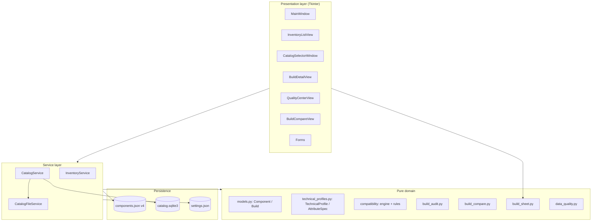

# Technical architecture — PC Parts Organizer

Architecture, contracts and compatibility-engine limits documentation. Complements `USER_GUIDE.md` and `MAINTENANCE.md`.

---

## 1. Layered architecture



- **UI**: presentation and events only. No persistence or business logic; it delegates to the service and domain views.
- **Service**: `InventoryService` (project state) and `CatalogService` (references). They are the only mutation path with persistence.
- **Pure domain**: models, compatibility engine, audit, comparer, quality and sheets. No I/O and no global-state mutation.
- **Persistence**: JSON for inventory/builds/profiles, SQLite for the catalog, JSON for settings.

## 2. Responsibilities

### UI

- `ui/main_window.py` coordinates views and operations, translating service results into dialogs.
- Specialized views: inventory, component details, builds, comparer, quality center, catalog selector and forms.
- Forms build candidates and validate them in the service; they never write.

### Service

- `InventoryService` manages `components`, `builds` and `technical_profiles` in memory.
- `CatalogService` operates on `CatalogStorage` (SQLite) with search, pagination and normalized-key duplicates.

### Models

- `Component`, `Build` with strict normalization and validation (categories, states, dates, prices).
- `TechnicalProfile` with typed attributes, provenance, confidence, evidence and verification states.

### Persistence

- `storage.py`: schema validation (accepts 1–4, writes 4), atomic writes (temp file + `os.replace`), safety copies, export/import and language.

## 3. `InventoryService`: transactional authority

Invariants (verified by the suite):

1. Full candidate validation **before** mutating state.
2. Atomic persistence: the complete verified state is written.
3. In-memory swap **only after** persisting correctly.
4. One transactional operation per logical mutation.
5. Single assignment of components to builds (`ComponentAlreadyAssignedError`).
6. Protection of assigned components (`ComponentInUseError`).
7. Preservation of profiles and metadata.

### `_commit`

```python
_commit(components, builds, technical_profiles=_PRESERVE_PROFILES)
```

- Validates and normalizes profiles (uniqueness of `component_id`, validity per category).
- Persists via `save_project_state` (or legacy `save_components` patch points).
- Updates in-memory state only after persisting.

### Batch operations

- `add_components(items) -> BatchAddResult(created, duplicates)`.
- `delete_components(ids) -> BatchDeleteResult(deleted, skipped_in_use, not_found)`.
- Duplicates by `catalog_duplicate_key` (category + manufacturer/model normalized with `casefold` and space collapsing).
- Total invalidation with `BatchValidationError.rejected` before writing; zero writes.
- A single `_commit` per effective operation; none if nothing changed.

## 4. Persistence

### Inventory JSON (`components.json`)

```json
{ "schema_version": 4, "components": [...], "builds": [...], "technical_profiles": [...] }
```

- Atomic write (temp + `os.replace`), UTF-8.
- `read_inventory_file(path, expected_sha256=...)` verifies integrity before operating.
- Restore creates a safety copy in `backups/pre-restore/`.

### Catalog SQLite (`catalog.sqlite3`)

- Reference table with `CATALOG_COLUMNS` columns, `CATALOG_SCHEMA_VERSION = 1`.
- `CatalogStorage` manages schema, insertion, search and duplicates; integrity is verified on initialization.
- `CatalogService` exposes `initialize`, `add_entry`, `get_entry`, `search_entries`, `count_entries`.

### Settings (`settings.json`)

- `{"schema_version": 1, "language": "es"|"en"}`; `load_language_preference` / `save_language_preference`.

## 5. Pure compatibility engine

```mermaid
flowchart LR
  B[Build + components + profiles] --> CTX[build_context: AnalysisContext]
  CTX --> R1[RAM-Motherboard]
  CTX --> R2[Motherboard-Case]
  CTX --> R3[GPU-Case]
  CTX --> R4[CPU-Cooling]
  CTX --> R5[Cooling-Case]
  CTX --> R6[CPU-Motherboard]
  CTX --> R7[Storage-M.2 / bays]
  CTX --> R8[SATA / topology]
  CTX --> R9[PSU connectors]
  CTX --> R10[PSU-Case]
  R1 & R2 & R3 & R4 & R5 & R6 & R7 & R8 & R9 & R10 --> F[CompatibilityFinding[]]
  F --> NE[not_evaluated_relations]
  F --> LIM[analysis_limitations]
  F & NE --> GR[global_result]
```

- `compatibility/engine.py`: `build_context`, `analyze_build_compatibility`, `global_result`. No I/O, no mutation.
- Per-module rules (`rules_*.py`) and storage classification (`storage_classification.py`).
- `ENGINE_RULESET_VERSION = "t17.12-v1"`.

### Finding model

```python
@dataclass(frozen=True)
class CompatibilityFinding:
    rule_id: str
    rule_version: str
    result: str            # compatible | incompatible | requires_verification | insufficient_data
    severity: str          # critical | warning | info
    component_ids: tuple[str, ...]
    attributes_compared: tuple[str, ...]
    evidence: Mapping[str, Any]
    message_key: str
    message_params: Mapping[str, Any]
    missing_information: tuple[str, ...]
    recommended_action: str
```

`CompatibilityReport` groups `overall_result`, `findings`, `ruleset_version`, `rules_evaluated`, `not_evaluated_relations` and `analysis_limitations`.

### `global_result`

| Priority | Result |
|---|---|
| 1 | `incompatible` if there is a critical finding |
| 2 | `requires_verification` if there are verification findings or unevaluated relationships |
| 3 | `insufficient_data` if there are insufficient-data findings or no applicable scope |
| 4 | `compatible` if all findings are compatible |
| 5 | `requires_verification` (default) |

### `not_evaluated` and limitations

- `not_evaluated_relations`: present categories without implemented rules, with reason.
- `analysis_limitations`: tokens describing unevaluated dimensions (e.g. PSU power, PCIe topology, GPU geometry).
- Both are always shown in the UI and in sheets; they are not errors.

## 6. Technical profiles and `AttributeSpec`

- `AttributeSpec` describes the type, allowed unit and validators per attribute.
- `ATTRIBUTE_REGISTRY` (versioned by `PROFILE_REGISTRY_VERSION = 7`) defines attributes per category.
- `PROFILE_VERSION = 2` describes the structural shape of the profile.
- `validate_profile_for_category` guarantees a profile is interpretable for the component's category.

### Epistemic states (`data_quality.py`)

`absent`, `unknown`, `unverified`, `low_confidence`, `missing_evidence`, `inconsistent_metadata`, `verified`, `not_applicable`.

- `verified` requires evidence + date (`_validate_verification_policy`).
- Pending states are grouped for the review queue.

### `CONSUMERS` registry

`CONSUMERS[(category, key)] -> (rule_ids...)` relates each attribute to the rules consuming it. It feeds the quality center and audit links.

## 7. Quality center

- `audit_inventory(components, profiles) -> QualityReport` with entries per (component, attribute).
- `review_queue(report, important_only=True)` orders pending items blocking rules.
- The UI filters by category/state and shows “used by” (consumer rules).

## 8. Build audit

- `build_audit(build, components, profiles, report) -> BuildAudit`.
- Grouped findings: `demonstrated` (incompatible), `pending_verification`, `insufficient`, `not_evaluated`, `limitations`.
- Attributes linked only through a **demonstrated relation**: `missing_information` naming (category, key) or rule context with real participants.
- `relevant_pending` (blocking) and `future_pending` (unevaluated rules) kept distinct.

## 9. Comparer

- `compare_hardware(a, b, ...) -> HardwareDiff`: common/added/removed/replaced.
- `correspondence_from_hardware(hw)`: demonstrated correspondences; ADDED/REMOVED/UNKNOWN never correspond by category alone.
- `compare_reports(a, b, corr) -> CompatDiff`: findings paired by participant correspondence; `new`, `common`, `resolved`.
- Explanations state the specific change (removed, corrected, etc.).

## 10. Bulk operations, CSV import and sheets

- Multi-select catalog selector: `multi=True` preserves selection across pages and returns stable entries.
- Conversion to inventory only with real-correspondence fields; commercial provenance is never transferred.
- **CSV import** (`csv_inventory_import.py`): pure analysis (`analyze_csv` → `CsvImportAnalysis` with `valid_new`, `inventory_duplicates`, `internal_duplicates`, `rejected`, `empty_rows`), validation with the real `Component`, duplicates with `catalog_duplicate_key` (via identity adapter), 5 MB / 50,000-row limits, `csv_template_text` template (UTF-8 with BOM).
- `preview_add_components` reclassifies with the same preparation as `add_components` without writing; the final import revalidates against the current inventory (a single `_commit`).
- `build_sheet.py`: `render_build_sheet(build, components, report, audit, translator, flavor)` and `export_build_sheet(..., active_inventory_path)` with atomic writes and refusal to overwrite the active inventory.

## 11. Localization

- `localization.py`: `Translator` with `es` (default) and `en`; dot-nested keys. The application UI is fully available in both languages; switch from the header selector.
- Exact parity of keys and placeholders between `locales/es.json` and `locales/en.json` (verified by tests).
- The preference persists in `settings.json`.

## 12. Tests and validation tooling

- `tests/`: `unittest` suite. Fail-closed isolation: redirects `LOCALAPPDATA` to a temporary TEMP dir before importing the package (`tests/_pcpo_test_isolation_bootstrap.py`).
- `tools/prepare_t*_visual_validation.py`: prepare synthetic data and real screenshots; never touch real data.

---

# Compatibility reference and technical limits

## Implemented relationships and real scope

| Relationship | Module | Real scope |
|---|---|---|
| RAM ↔ Motherboard | `rules_ram_mb.py` | Generation, module form factor, total capacity, slot count |
| Motherboard ↔ Case | `rules_mb_case.py` | Board form factor supported by the case |
| GPU ↔ Case | `rules_gpu_case.py` | Declared length only (no height, thickness, slots, clearances) |
| CPU ↔ Cooling | `rules_cpu_cooling.py` | Declared socket; no thermal capacity or full mounting |
| Cooling ↔ Case | `rules_cooling_case.py` | Air-cooler height; no full radiator/liquid-mounting |
| CPU ↔ Motherboard | `rules_cpu_mb.py` | Socket designation; no chipset/BIOS/VRM |
| Storage ↔ Case | `rules_storage.py` | Declared bay capacity; no free space/adapters |
| Storage ↔ Motherboard (M.2) | `rules_storage.py` | Declared keying/length fit; no full topology |
| SATA | `rules_storage_sata.py` | Declared count and availability; no physical assignment/BIOS |
| PSU ↔ connectors | `rules_psu_connectors.py` | Declared connector inventory vs. requirements |
| PSU ↔ Case | `rules_psu_case.py` | Declared form factor; no exact depth/cable clearance |

## When a demonstrated incompatibility is allowed

Only with **verified attributes** (evidence + date) supporting a concrete technical contradiction between the involved parties. Without sufficient verification, the result degrades to `requires_verification` or `insufficient_data`.

## What attribute verification requires

- `evidence_ref` (reference) and `verified_at` (date) for `verified`.
- Recorded confidence (high/medium/low) and declared provenance.
- Collection completeness when the rule requires it (e.g. M.2 slot inventory, SATA ports, PSU cables) to support coverage claims.

## Difference between results

| Result | When | Implication |
|---|---|---|
| `compatible` | Relationship evaluated with sufficient verified data | That relationship only; does not certify other dimensions |
| `incompatible` | Confirmed technical contradiction (critical) | Requires correction or replacement |
| `requires_verification` | Insufficiently verified data | Not an incompatibility; evidence must be provided |
| `insufficient_data` | Missing attributes or no applicable scope | Cannot conclude |

## Why `compatible` does not guarantee total evaluation

`compatible` applies to specific relationships and declared dimensions. It does not imply that overall physical, electrical, thermal or functional compatibility has been evaluated: the engine explicitly declares uncovered dimensions in `not_evaluated` and `analysis_limitations`.

## Closed or deferred dimensions (NOT available)

These dimensions are **not engine features**; they are not evaluated and must be considered out of scope:

- **PCIe and lane assignment**: no lanes, effective generation/lanes or distribution across devices are modeled.
- **PSU electrical power**: no wattage, currents, margins, transients or electrical safety are evaluated.
- **Modular pinout**: no modular-cable pinouts or physical cable assignment are validated.
- **Thermal capacity**: socket match does not evaluate dissipation or thermal behavior.
- **Unmodeled GPU geometry**: declared length only; no height, thickness, slots, interference or tolerances.
- **Cooler ↔ RAM clearance**: no interference with memory, VRM, fans or panels is evaluated.
- **Resource solver and automatic assignment**: no optimizer or automatic slot/port/cable assigner exists.

Any conclusion about these dimensions requires external verification (manufacturer documentation) and cannot be inferred from a `compatible` result.

---

# Development and testing guide

## Running tests

```bat
python -m unittest discover
```

Isolation: the bootstrap redirects `LOCALAPPDATA` to a temporary TEMP dir and deletes it on exit. Real data is never touched.

## `py_compile`

```bat
python -m py_compile pc_parts_organizer\service.py pc_parts_organizer\storage.py
```

## ES/EN parity

`tests/test_localization.py` and `tests/test_governance_t1717.py` check key and placeholder equality. To validate manually:

```bat
python -m unittest tests.test_localization tests.test_governance_t1717
```

## Synthetic storage

Tests and tools use `LOCALAPPDATA` pointing at a temporary directory; the preparers (`tools/prepare_t*_visual_validation.py`) require `--target` under `%TEMP%` and refuse paths overlapping real data.

## Fixtures and persistence

Create fixtures with `save_project_state(components, builds, profiles)` inside the isolated TEMP; validate with `read_inventory_file`. Never write to the real inventory path.

## Visual validations

```bat
python tools\prepare_t1720v_visual_validation.py --target %TEMP%\t1720v-walk
```

They generate real screenshots, run walkthroughs and write reports to `%TEMP%`. They declare `visual_manual_completed:false`; manual acceptance is separate.

## SHA256 backups

Preparers create manifests with `manifest-*.json` (SHA256 + `all_match`). Recompute hashes with `hashlib.sha256` and compare; do not regenerate other people's manifests.

## Adding a new compatibility rule

1. Add the `compatibility/rules_<relationship>.py` module with an `evaluate_*(ctx) -> list[CompatibilityFinding]` function.
2. Register the call in `analyze_build_compatibility` and update `IMPLEMENTED_RELATIONS`.
3. Add translation keys for `rule_labels`, `messages`, `recommended_actions` in **both** languages with matching placeholders.
4. Add tests demonstrating the verdict and degradation to `requires_verification`/`insufficient_data`.

## Adding attributes to `AttributeSpec`

1. Define the `AttributeSpec` in `_make_registry()` with type/unit and validators.
2. Add the label in `locales/*.json` under `technical_profile.attributes`.
3. Update `PROFILE_REGISTRY_VERSION` only if validation semantics change; document the change.
4. Add normalizers/validation in `technical_profiles.py` if the value needs treatment.

## Updating `CONSUMERS`

Add the `(category, key) -> (rule_ids...)` entry in `data_quality.py` so the quality center and audit link the attribute to its consumers.

## Keeping finding and translation contracts

- `CompatibilityFinding` is frozen (`frozen=True`); field changes break reports.
- `message_key`/`message_params` must resolve in `locales` with the same placeholders in ES and EN.
- Every new incompatibility must be degradable without verification; do not introduce `incompatible` findings without verified attributes.
