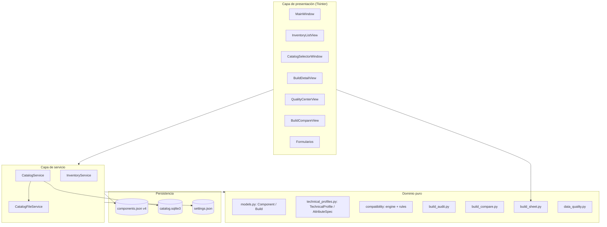

# Arquitectura técnica — PC Parts Organizer

Documentación de arquitectura, contratos y límites del motor de compatibilidad. Complementa a `GUIA_USUARIO.md` y `MANTENIMIENTO.md`.

---

## 1. Arquitectura por capas



- **UI**: solo presentación y eventos. Sin persistencia ni lógica de negocio; delega en el servicio y en las vistas de dominio.
- **Servicio**: `InventoryService` (estado del proyecto) y `CatalogService` (referencias). Son la única vía de mutación con persistencia.
- **Dominio puro**: modelos, motor de compatibilidad, auditoría, comparador, calidad y fichas. Sin I/O y sin mutación de estado global.
- **Persistencia**: JSON para inventario/builds/perfiles, SQLite para el catálogo, JSON para ajustes.

## 2. Responsabilidades

### UI

- `ui/main_window.py` coordina vistas y operaciones, traduce resultados del servicio a diálogos.
- Vistas especializadas: inventario, detalle de componente, builds, comparador, centro de calidad, selector de catálogo y formularios.
- Los formularios construyen candidatos y los validan en el servicio; nunca escriben.

### Servicio

- `InventoryService` gestiona `components`, `builds` y `technical_profiles` en memoria.
- `CatalogService` opera sobre `CatalogStorage` (SQLite) con búsqueda, paginación y duplicados por clave normalizada.

### Modelos

- `Component`, `Build` con normalización y validación estricta (categorías, estados, fechas, precios).
- `TechnicalProfile` con atributos tipados, procedencia, confianza, evidencia y estados de verificación.

### Persistencia

- `storage.py`: validación de esquemas (acepta 1–4, escribe 4), escritura atómica (temporal + `os.replace`), copias preventivas, exportación/importación y lenguaje.

## 3. `InventoryService`: autoridad transaccional

Invariantes (verificadas por la suite):

1. Validación completa del candidato **antes** de modificar el estado.
2. Persistencia atómica: se escribe el estado completo y verificado.
3. Conmutación de memoria **solo después** de persistir correctamente.
4. Una operación transaccional por mutación lógica.
5. Asignación única de componentes a builds (`ComponentAlreadyAssignedError`).
6. Protección de componentes asignados (`ComponentInUseError`).
7. Conservación de perfiles y metadatos.

### `_commit`

```python
_commit(components, builds, technical_profiles=_PRESERVE_PROFILES)
```

- Valida y normaliza perfiles (unicidad de `component_id`, validez por categoría).
- Persiste vía `save_project_state` (o puntos de parcheo heredados `save_components`).
- Actualiza el estado en memoria solo tras persistir.

### Operaciones por lote

- `add_components(items) -> BatchAddResult(created, duplicates)`.
- `delete_components(ids) -> BatchDeleteResult(deleted, skipped_in_use, not_found)`.
- Duplicados por `catalog_duplicate_key` (categoría + fabricante/modelo normalizados con `casefold` y colapso de espacios).
- Invalidación total con `BatchValidationError.rejected` antes de escribir; cero escrituras.
- Un único `_commit` por operación efectiva; ninguna si no hay cambios.

## 4. Persistencia

### JSON del inventario (`components.json`)

```json
{ "schema_version": 4, "components": [...], "builds": [...], "technical_profiles": [...] }
```

- Escrita atómica (temp + `os.replace`), UTF-8.
- `read_inventory_file(path, expected_sha256=...)` verifica integridad antes de operar.
- La restauración crea una copia preventiva en `backups/pre-restore/`.

### Catálogo SQLite (`catalog.sqlite3`)

- Tabla de referencias con columnas `CATALOG_COLUMNS`, `CATALOG_SCHEMA_VERSION = 1`.
- `CatalogStorage` gestiona esquema, alta, búsqueda y duplicados; se verifica integridad al inicializar.
- `CatalogService` expone `initialize`, `add_entry`, `get_entry`, `search_entries`, `count_entries`.

### Ajustes (`settings.json`)

- `{"schema_version": 1, "language": "es"|"en"}`; `load_language_preference` / `save_language_preference`.

## 5. Motor de compatibilidad (puro)

```mermaid
flowchart LR
  B[Build + components + profiles] --> CTX[build_context: AnalysisContext]
  CTX --> R1[RAM-Motherboard]
  CTX --> R2[Motherboard-Case]
  CTX --> R3[GPU-Case]
  CTX --> R4[CPU-Cooling]
  CTX --> R5[Cooling-Case]
  CTX --> R6[CPU-Motherboard]
  CTX --> R7[Storage-M.2 / bahías]
  CTX --> R8[SATA / topología]
  CTX --> R9[PSU conectores]
  CTX --> R10[PSU-Case]
  R1 & R2 & R3 & R4 & R5 & R6 & R7 & R8 & R9 & R10 --> F[CompatibilityFinding[]]
  F --> NE[not_evaluated_relations]
  F --> LIM[analysis_limitations]
  F & NE --> GR[global_result]
```

- `compatibility/engine.py`: `build_context`, `analyze_build_compatibility`, `global_result`. Sin I/O ni mutación.
- Reglas por módulo (`rules_*.py`) y clasificación de almacenamiento (`storage_classification.py`).
- `ENGINE_RULESET_VERSION = "t17.12-v1"`.

### Modelo de findings

```python
@dataclass(frozen=True)
class CompatibilityFinding:
    rule_id: str
    rule_version: str
    result: str            # compatible | incompatible | requires_verification | insufficient_data
    severity: str          # critical | warning | info
    component_ids: tuple[str, ...]
    attributes_compared: tuple[str, ...]
    evidence: Mapping[str, Any]
    message_key: str
    message_params: Mapping[str, Any]
    missing_information: tuple[str, ...]
    recommended_action: str
```

`CompatibilityReport` agrupa `overall_result`, `findings`, `ruleset_version`, `rules_evaluated`, `not_evaluated_relations` y `analysis_limitations`.

### `global_result`

| Prioridad | Resultado |
|---|---|
| 1 | `incompatible` si hay hallazgo crítico |
| 2 | `requires_verification` si hay hallazgos de verificación o relaciones no evaluadas |
| 3 | `insufficient_data` si hay hallazgos de datos insuficientes o no hay alcance aplicable |
| 4 | `compatible` si todos los hallazgos son compatibles |
| 5 | `requires_verification` (por defecto) |

### `not_evaluated` y limitaciones

- `not_evaluated_relations`: categorías presentes sin reglas implementadas, con motivo.
- `analysis_limitations`: tokens que describen dimensiones no evaluadas (p. ej. potencia eléctrica, topología PCIe, geometría GPU).
- Ambos se muestran siempre en la UI y en las fichas; no son errores.

## 6. Perfiles técnicos y `AttributeSpec`

- `AttributeSpec` describe tipo, unidad permitida y validadores por atributo.
- `ATTRIBUTE_REGISTRY` (versionado por `PROFILE_REGISTRY_VERSION = 7`) define atributos por categoría.
- `PROFILE_VERSION = 2` describe la forma estructural del perfil.
- `validate_profile_for_category` garantiza que un perfil sea interpretable para la categoría del componente.

### Estados epistemológicos (`data_quality.py`)

`absent`, `unknown`, `unverified`, `low_confidence`, `missing_evidence`, `inconsistent_metadata`, `verified`, `not_applicable`.

- `verified` exige evidencia + fecha (`_validate_verification_policy`).
- Los estados pendientes se agrupan para la cola de revisión.

### Registro `CONSUMERS`

`CONSUMERS[(category, key)] -> (rule_ids...)` relaciona cada atributo con las reglas que lo consumen. Alimenta el centro de calidad y los enlaces de auditoría.

## 7. Centro de calidad

- `audit_inventory(components, profiles) -> QualityReport` con entradas por (componente, atributo).
- `review_queue(report, important_only=True)` ordena pendientes que bloquean reglas.
- La UI filtra por categoría/estado y muestra «usado por» (reglas consumidoras).

## 8. Auditoría de builds

- `build_audit(build, components, profiles, report) -> BuildAudit`.
- Hallazgos agrupados: `demonstrated` (incompatible), `pending_verification`, `insufficient`, `not_evaluated`, `limitations`.
- Atributos enlazados solo por **relación demostrada**: `missing_information` que nombra (category, key) o contexto de regla con participantes reales.
- `relevant_pending` (bloqueantes) y `future_pending` (reglas no evaluadas) diferenciados.

## 9. Comparador

- `compare_hardware(a, b, ...) -> HardwareDiff`: comunes/añadidos/retirados/sustituidos.
- `correspondence_from_hardware(hw)`: correspondencias demostradas; ADDED/REMOVED/UNKNOWN nunca se corresponden por categoría sola.
- `compare_reports(a, b, corr) -> CompatDiff`: hallazgos pareados por correspondencia de participantes; `new`, `common`, `resolved`.
- Las explicaciones indican el cambio concreto (retirado, corregido, etc.).

## 10. Operaciones masivas, importación CSV y fichas

- Selector de catálogo multiselección: `multi=True` conserva selección entre páginas y devuelve entradas estables.
- Conversión a inventario solo con campos con equivalencia real; la procedencia comercial no se transfiere.
- **Importación CSV** (`csv_inventory_import.py`): análisis puro (`analyze_csv` → `CsvImportAnalysis` con `valid_new`, `inventory_duplicates`, `internal_duplicates`, `rejected`, `empty_rows`), validación con el `Component` real, duplicados con `catalog_duplicate_key` (vía adaptador de identidad), límites 5 MB / 50 000 filas, plantilla `csv_template_text` (UTF-8 con BOM).
- `preview_add_components` reclasifica con la misma preparación que `add_components` sin escribir; la incorporación final vuelve a validar contra el inventario actual (un solo `_commit`).
- `build_sheet.py`: `render_build_sheet(build, components, report, audit, translator, flavor)` y `export_build_sheet(..., active_inventory_path)` con escritura atómica y rechazo de sobrescritura del inventario activo.

## 11. Localización

- `localization.py`: `Translator` con `es` (predeterminado) y `en`; claves anidadas con puntos.
- Paridad exacta de claves y placeholders entre `locales/es.json` y `locales/en.json` (verificada por tests).
- La preferencia se persiste en `settings.json`.

## 12. Pruebas y herramientas de validación

- `tests/`: suite `unittest`. Aislamiento fail-closed: redirige `LOCALAPPDATA` a un TEMP temporal antes de importar el paquete (`tests/_pcpo_test_isolation_bootstrap.py`).
- `tools/prepare_t*_visual_validation.py`: preparan datos sintéticos y capturas reales; nunca tocan datos reales.

---

# Referencia de compatibilidad y límites técnicos

## Relaciones implementadas y alcance real

| Relación | Módulo | Alcance real |
|---|---|---|
| RAM ↔ Motherboard | `rules_ram_mb.py` | Generación, formato de módulo, capacidad total, número de ranuras |
| Motherboard ↔ Case | `rules_mb_case.py` | Formato de placa soportado por la caja |
| GPU ↔ Case | `rules_gpu_case.py` | Solo longitud declarada (no altura, grosor, ranuras, holguras) |
| CPU ↔ Cooling | `rules_cpu_cooling.py` | Socket declarado; sin capacidad térmica ni montaje completo |
| Cooling ↔ Case | `rules_cooling_case.py` | Altura de disipador de aire; sin radiador/montaje líquido completo |
| CPU ↔ Motherboard | `rules_cpu_mb.py` | Designación de socket; sin chipset/BIOS/VRM |
| Storage ↔ Case | `rules_storage.py` | Capacidad de bahías declarada; sin espacio libre/adaptadores |
| Storage ↔ Motherboard (M.2) | `rules_storage.py` | Encaje por keying/longitud declarados; sin topología completa |
| SATA | `rules_storage_sata.py` | Recuento y disponibilidad declarados; sin asignación física/BIOS |
| PSU ↔ conectores | `rules_psu_connectors.py` | Inventario declarado de conectores vs requisitos |
| PSU ↔ Case | `rules_psu_case.py` | Formato declarado; sin profundidad exacta/holgura de cables |

## Cuándo se permite una incompatibilidad demostrada

Solo con **atributos verificados** (evidencia + fecha) que permitan una contradicción técnica concreta entre las partes implicadas. Sin verificación suficiente, el resultado se degrada a `requires_verification` o `insufficient_data`.

## Qué exige la verificación de atributos

- `evidence_ref` (referencia) y `verified_at` (fecha) para `verified`.
- Confianza registrada (alta/media/baja) y procedencia declarada.
- Completitud de colecciones cuando la regla lo exige (p. ej. inventario de ranuras M.2, puertos SATA, cables PSU) para sostener afirmaciones de cobertura.

## Diferencia entre resultados

| Resultado | Cuándo | Implicación |
|---|---|---|
| `compatible` | Relación evaluada con datos verificados suficientes | Solo esa relación; no certifica otras dimensiones |
| `incompatible` | Contradicción técnica confirmada (crítica) | Requiere corrección o sustitución |
| `requires_verification` | Datos no suficientemente verificados | No es incompatibilidad; hay que aportar evidencia |
| `insufficient_data` | Faltan atributos o no hay alcance aplicable | No puede concluir |

## Por qué `compatible` no garantiza evaluación total

`compatible` se aplica a relaciones concretas y dimensiones declaradas. No implica que la compatibilidad física, eléctrica, térmica o de funcionamiento global haya sido evaluada: el motor declarta explícitamente las dimensiones no cubiertas en `not_evaluated` y `analysis_limitations`.

## Dimensiones cerradas o aplazadas (NO disponibles)

Estas dimensiones **no son funcionalidades del motor**; no se evalúan y deben considerarse fuera de alcance:

- **PCIe y asignación de carriles**: no se modelan carriles, generación/lanes efectivos ni reparto entre dispositivos.
- **Potencia eléctrica PSU**: no se evalúan vatios, corrientes, márgenes, transitorios ni seguridad eléctrica.
- **Pinout modular**: no se validan pinouts de cables modulares ni la asignación física de cables.
- **Capacidad térmica**: la coincidencia de socket no evalúa disipación ni comportamiento térmico.
- **Geometría GPU no modelada**: solo longitud declarada; no altura, grosor, ranuras, interferencias ni tolerancias.
- **Holgura disipador ↔ RAM**: no se evalúan interferencias con memoria, VRM, ventiladores o paneles.
- **Solver y asignación automática de recursos**: no existe optimizador ni asignador automático de ranuras/puertos/cables.

Cualquier conclusión sobre estas dimensiones requiere verificación externa (documentación del fabricante) y no puede inferirse de un resultado `compatible`.

---

# Guía de desarrollo y pruebas

## Ejecutar tests

```bat
python -m unittest discover
```

Aislamiento: el bootstrap redirige `LOCALAPPDATA` a un TEMP temporal y lo elimina al salir. Nunca se tocan los datos reales.

## `py_compile`

```bat
python -m py_compile pc_parts_organizer\service.py pc_parts_organizer\storage.py
```

## Paridad ES/EN

`tests/test_localization.py` y `tests/test_governance_t1717.py` comprueban igualdad de claves y placeholders. Para validar manualmente:

```bat
python -m unittest tests.test_localization tests.test_governance_t1717
```

## Almacenamiento sintético

Los tests y las herramientas usan `LOCALAPPDATA` apuntando a un directorio temporal; los preparadores (`tools/prepare_t*_visual_validation.py`) exigen `--target` bajo `%TEMP%` y rechazan rutas que solapen los datos reales.

## Fixtures y persistencia

Crea fixtures con `save_project_state(components, builds, profiles)` dentro del TEMP aislado; valida con `read_inventory_file`. Nunca escribas en la ruta real del inventario.

## Validaciones visuales

```bat
python tools\prepare_t1720v_visual_validation.py --target %TEMP%\t1720v-walk
```

Generan capturas reales, ejecutan recorridos y escriben informes en `%TEMP%`. Declaran `visual_manual_completed:false`; la aceptación manual es aparte.

## Backups SHA256

Los preparadores crean manifiestos con `manifest-*.json` (SHA256 + `all_match`). Recalcula hashes con `hashlib.sha256` y compara; no regeneres manifiestos ajenos.

## Incorporar una nueva regla de compatibilidad

1. Añade el módulo `compatibility/rules_<relacion>.py` con una función `evaluate_*(ctx) -> list[CompatibilityFinding]`.
2. Registra la llamada en `analyze_build_compatibility` y actualiza `IMPLEMENTED_RELATIONS`.
3. Añade claves de traducción para `rule_labels`, `messages`, `recommended_actions` en **ambos** idiomas con placeholders coincidentes.
4. Añade tests que demuestren veredicto y degradación a `requires_verification`/`insufficient_data`.

## Añadir atributos a `AttributeSpec`

1. Define el `AttributeSpec` en `_make_registry()` con tipo/unidad y validadores.
2. Añade la etiqueta en `locales/*.json` bajo `technical_profile.attributes`.
3. Actualiza `PROFILE_REGISTRY_VERSION` solo si cambia la semántica de validación; documenta el cambio.
4. Añade normalizadores/validación en `technical_profiles.py` si el valor requiere tratamiento.

## Actualizar `CONSUMERS`

Añade la entrada `(category, key) -> (rule_ids...)` en `data_quality.py` para que el centro de calidad y la auditoría enlacen el atributo con sus consumidores.

## Mantener contratos de findings y traducciones

- `CompatibilityFinding` es congelado (`frozen=True`); los cambios de campos son breaking para reportes.
- `message_key`/`message_params` deben resolver en `locales` con los mismos placeholders en ES y EN.
- Toda incompatibilidad nueva debe poder degradarse sin verificación; no introduzcas hallazgos `incompatible` sin atributos verificados.
